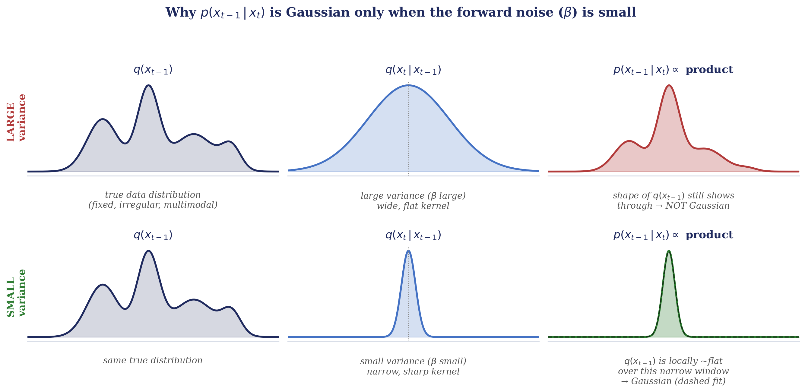
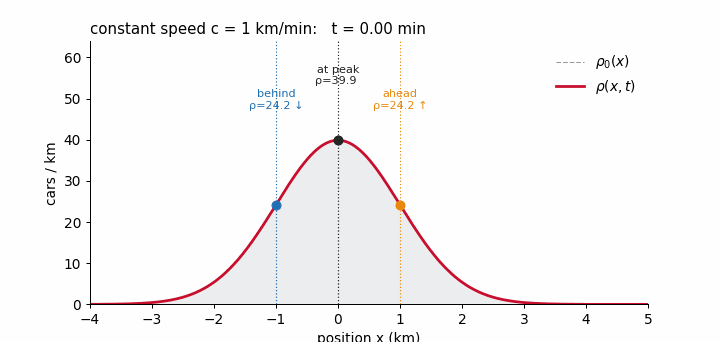
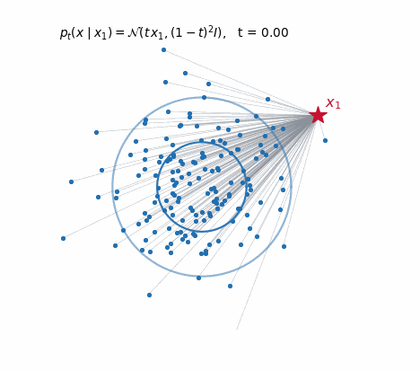
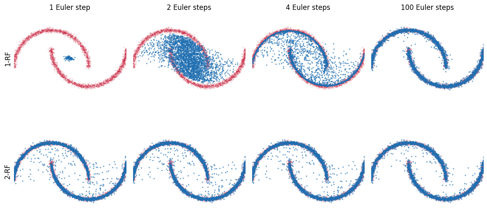

---
Authors:
 Isaac Peterson and Jacob Morrey
Title: "From Noise to Point Clouds: Flow Matching for LiDAR"
---

# Why a state estimator cares about generating LiDAR

A Kalman filter needs a measurement model: given the state, what does the sensor report? For a spinning LiDAR in a real building that model is hopeless to write down. Returns depend on materials, incidence angle, clutter, and the robot's own body. What we can do is collect scans and learn the distribution of what a scan looks like.

That is a generative model: a way to draw samples from $p(\text{scan})$. Once you have one, you can (a) fill in simulated data that looks real, (b) check whether a real scan is in-distribution, and (c) use it as a prior in a Bayesian update.

This post is about one family of generative models, diffusion and flow matching, and one application of it, LiDAR range images. We cover the math, then the specific model our lab uses, R2Flow ([Nakashima, 2025](https://arxiv.org/abs/2412.02241)), then what happened when we pointed it at a Unitree Go2 robot with LiDAR in simulation.

# Building the Theory

Our goal is to generate new LiDAR range images that capture the geometric and statistical properties of real sensor observations. We will build up the theoretical background for this problem, starting with diffusion models and using them to motivate flow matching and rectified flow.

#### Formalizing the Goal

Suppose we have a dataset of LiDAR range images sampled from some unknown data distribution $p_{\mathrm{data}}(x)$, where $x \in \mathbb{R}^d$ represents a range image with $d$ values. We want to construct a generative model, parameterized by $\theta$, that produces new samples from a learned distribution $p_\theta(x)$ such that

$$p_\theta(x) \approx p_{\mathrm{data}}(x).$$

In other words, we want to generate new range images that are statistically indistinguishable from real observations, without simply reproducing examples from the training dataset.

#### A Geometric Interpretation

One way to understand this problem is to consider the geometry of the data distribution. Although a LiDAR range image may contain thousands of values, those values are not independent. They are constrained by the geometry of the environment, the position and orientation of the sensor, and the physical characteristics of the measurement process.

Consequently, realistic range images occupy only a small, highly structured region of the space of all possible range images. We can think of this region as a data manifold, $\mathcal{M} \subseteq \mathbb{R}^d$, on or near which real observations are concentrated. This is a common assumption in machine learning called the manifold hypothesis, a statistical exploration can be found in [Whiteley, 2026](https://arxiv.org/abs/2208.11665).

From this perspective, generating a realistic range image amounts to producing a point on or near this manifold. An arbitrary point in the ambient space is unlikely to represent a physically plausible observation, but a point in the region occupied by real data is much more likely to exhibit the structure we want.

However, reaching the data manifold alone is not sufficient. We also want our generated samples to follow the same distribution as real observations, capturing both the diversity of possible scenes and their relative likelihoods.

#### Learning to Generate Samples

Directly characterizing this high-dimensional distribution is difficult, particularly because its probability density is unknown and may be computationally intractable to evaluate.

To illustrate this, consider a simple LiDAR measurement model, similar to what we might use in a Kalman filter:

$$x = h(s) + \epsilon,
    \qquad
    \epsilon \sim \mathcal{N}(0, R),$$

where $s$ represents the environment and sensor pose, $h(s)$ predicts the corresponding LiDAR measurements, and $\epsilon$ represents measurement noise. If the environment is known, we can approximate the distribution of measurements with a Gaussian:

$$p(x \mid s) = \mathcal{N}(x; h(s), R).$$

However, our goal is not to generate noisy measurements of a particular known environment. We want to generate observations of entirely new environments. This requires modeling the distribution across all possible scenes and sensor configurations:

$$p_{\mathrm{data}}(x)
    = \int p(x \mid s)\,p(s)\,ds.$$

Unlike the conditional measurement distribution, this marginal distribution is much more difficult to characterize. The space of possible environments is enormous, and the resulting distribution of LiDAR observations is highly structured and potentially multimodal. Even if we could accurately model the measurement noise, we would still need to describe the distribution of possible scenes and integrate over them.

Rather than attempting to evaluate this distribution directly, we can instead learn a process that generates samples from it. Let $z \sim p_{\mathrm{prior}}(z)$, where $p_{\mathrm{prior}}$ is a simple distribution such as a standard Gaussian. We seek a learned transformation $T_\theta$ such that

$$z \sim p_{\mathrm{prior}},
    \qquad
    \hat{x} = T_\theta(z),
    \qquad
    \hat{x} \sim p_\theta \approx p_{\mathrm{data}}.$$

Geometrically, this transformation moves samples from a simple distribution into the structured region occupied by real LiDAR observations. If learned successfully, it produces samples that not only lie near the data manifold but also reproduce the distribution of real observations across it.

Diffusion models and flow matching models provide two approaches to learning such a generative process. Both progressively transform samples from a simple noise distribution into samples from a complex data distribution, but differ in how the transformation is constructed and learned.

## Diffusion

Recall that our goal is to learn a transformation from a simple prior distribution $p_{\mathrm{prior}}$ to the complex data distribution $p_{\mathrm{data}}$. Diffusion models approach this problem by breaking the transformation into a sequence of small steps, rather than attempting to learn the entire mapping at once.

Diffusion models use two processes:

1.  a forward process, denoted by $q$, which takes a real sample of a lidar range image and moves it off of the data manifold and onto a chosen simple distribution, in this case a Gaussian.

2.  a reverse process, $p_\theta$, which reverses the forward process and takes a sample of Gaussian noise and moves it onto the data manifold.

![The forward process moves a data sample $x_0$ off the manifold, and the reverse process walks a noise sample back onto it. Every panel is the bird's eye view of the point cloud decoded from $x_t$. The left leg is the forward noising of one real Go2-W scan; the right leg is the exact reverse posterior chain $q(x_{t-1}\mid x_t,x_0)$ aimed at a different real scan, which is the trajectory the learned $p_\theta$ has to imitate without ever being shown its target. Coming back down somewhere else on the manifold is what makes this a generative model.](figs/diffusion/diffusion_manifold.png)

### Forward Process

Start with a data sample $x_0 \sim p_{\mathrm{data}}$, where $x_0$ is a real range image gathered from our LiDAR sensor. We want to gradually transform $x_0$ into a sample from a simple distribution, ideally a standard Gaussian $\mathcal{N}(0,I)$.

To construct such a process, let's look to physics, specifically Brownian motion. Brownian motion describes the random movement of particles suspended in a gas or liquid due to collisions with surrounding molecules. When a group of particles is initially concentrated in one region, this random motion causes their probability distribution to spread out over time, a phenomenon known as diffusion.

If $p(x,t)$ represents the probability density of finding a particle at position $x$ at time $t$, then under ideal Brownian motion, the distribution evolves according to the diffusion equation:

$$\frac{\partial p(x,t)}{\partial t}
    = D\nabla^2 p(x,t),$$

where $D$ is the diffusion coefficient and $\nabla^2$ is the Laplacian operator, which describes how the probability density varies locally in space.

The random motion of an individual particle can be modeled by the stochastic differential equation (SDE)

$$dX_t = \sqrt{2D}\,dW_t,$$

where $W_t$ is a Wiener process, representing continuous random motion.

Starting from $X_0=x_0$, the solution is

$$X_t = x_0 + \sqrt{2Dt}\,\epsilon,
    \qquad \epsilon \sim \mathcal{N}(0,I).$$

Notice that $\sqrt{2Dt}$ is simply a scalar multiplying the Gaussian random variable. Since scaling a random variable by a factor $a$ scales its covariance by $a^2$, we have

$$\sqrt{2Dt}\,\epsilon
    \sim \mathcal{N}(0,2DtI).$$

Therefore, the probability distribution of the particle's position after time $t$ is

$$p(x_t\mid x_0)
    = \mathcal{N}(x_t;x_0,2DtI).$$

This tells us that Brownian motion is equivalent to repeatedly adding small amounts of Gaussian noise. As time increases, the variance grows and the distribution spreads farther from its initial position.

But remember, we want to transform our data to a standard Gaussian, $x_0$ to $x_T \sim \mathcal{N}(0,I)$. Pure Brownian motion does not converge to a standard Gaussian. Its variance grows without bound as $t \rightarrow \infty$. For our generative model, we instead want a process that gradually removes the original signal while introducing noise, eventually leaving a distribution close to $\mathcal{N}(0,I)$.

We can accomplish this by first making it a discrete time process, $t \in \{0, ..., T\}$. Then modifying each step to both scale down the previous sample and add Gaussian noise:

$$\tag{1}
    x_t = \sqrt{1-\beta_t}\,x_{t-1}
    + \sqrt{\beta_t}\,\epsilon_t,
    \qquad \epsilon_t\sim\mathcal{N}(0,I),$$

where $\beta_t \in (0,1)$ controls the amount of noise added at step $t$.

Note: $\beta_t$ follows a noise schedule $[\beta_0, ..., \beta_T]$. You can choose to learn this schedule or just set it beforehand. We will assume it is a set schedule like it is in the original paper ([Ho, 2020](https://arxiv.org/abs/2006.11239)).

Equivalently, we can express this transition as a conditional probability distribution:

$$q(x_t\mid x_{t-1})
    = \mathcal{N}\left(
        x_t;
        \sqrt{1-\beta_t}\,x_{t-1},
        \beta_t I
    \right).$$

To understand how these small steps accumulate, consider again the forward process in Eq. (1) above. Define

$$\alpha_t = 1-\beta_t,\qquad
    \bar{\alpha}_t = \prod_{s=1}^{t}\alpha_s.$$

Substituting $\alpha_t$ into our forward process gives

$$x_t = \sqrt{\alpha_t}x_{t-1}
    + \sqrt{1-\alpha_t}\epsilon_t.$$

Expanding the first two steps, we have

$$\begin{aligned}
    x_1 &= \sqrt{\alpha_1}x_0
    + \sqrt{1-\alpha_1}\epsilon_1,\\
    x_2 &= \sqrt{\alpha_2\alpha_1}x_0
    + \sqrt{\alpha_2(1-\alpha_1)}\epsilon_1
    + \sqrt{1-\alpha_2}\epsilon_2.
\end{aligned}$$

Since $\epsilon_1$ and $\epsilon_2$ are independent standard Gaussian random variables, their weighted sum is also Gaussian. In particular, for independent $\epsilon_1,\epsilon_2\sim\mathcal{N}(0,I)$,

$$a\epsilon_1+b\epsilon_2
    \sim \mathcal{N}(0,(a^2+b^2)I).$$

Applying this property to the two noise terms in $x_2$, their combined covariance becomes

$$\begin{aligned}
    \Sigma
    &= \left[\alpha_2(1-\alpha_1)+(1-\alpha_2)\right]I\\
    &= (1-\alpha_1\alpha_2)I.
\end{aligned}$$

We can therefore express $x_2$ using a single Gaussian noise term:

$$x_2 \overset{d}{=}
    \sqrt{\alpha_1\alpha_2}x_0
    + \sqrt{1-\alpha_1\alpha_2}\epsilon,
    \qquad \epsilon\sim\mathcal{N}(0,I).$$

Repeating this process for subsequent steps gives the general result

$$\tag{2}
    x_t \overset{d}{=}
    \sqrt{\bar{\alpha}_t}x_0
    + \sqrt{1-\bar{\alpha}_t}\epsilon,
    \qquad \epsilon\sim\mathcal{N}(0,I).$$

Equivalently, the conditional distribution of $x_t$ given $x_0$ is

$$q(x_t\mid x_0)
    = \mathcal{N}\left(
        x_t;
        \sqrt{\bar{\alpha}_t}x_0,
        (1-\bar{\alpha}_t)I
    \right).$$

This gives us a closed-form expression for sampling from any step of the forward process without computing all the preceding steps.

) with $T=1000$. Every individual $\beta_t$ is small (a), but $\bar\alpha_t$ compounds a thousand of them, so the signal coefficient $\sqrt{\bar\alpha_t}$ has collapsed and the noise coefficient $\sqrt{1-\bar\alpha_t}$ has saturated well before $t=T$ (b). The signal-to-noise ratio crosses $1$ at $t\approx 259$ (c). The dots in (b) mark the timesteps shown in the next figure.](figs/diffusion/noise_schedule.png)

Finally, if we choose a noise schedule such that $\bar{\alpha}_T \approx 0$, the contribution of the original sample vanishes while the noise covariance approaches $I$:

$$x_T \approx \epsilon,
    \qquad \epsilon\sim\mathcal{N}(0,I).$$

Thus, the marginal distribution $q(x_T)$ approaches a standard Gaussian, completing our forward diffusion process.

![Eq. (2) applied to a real scan: one Go2-W simulator sweep projected onto the sensor's $40\times512$ ray grid and encoded as log-scale depth in $[-1,1]$, which is what the models actually train on. Top: the range image $x_t$, with a single draw of $\epsilon$ held fixed across $t$ so the rows are comparable. Bottom: the same $x_t$ decoded back to a point cloud. The room is still legible at $t=25$ and survives faintly to $t=75$, long after the per-step noise looks destructive.](figs/diffusion/forward_lidar.png)

### Reverse Process

Remember, our ultimate goal is to learn to sample from our original data distribution, real LiDAR range images. It is very easy to sample from Gaussian noise and now that we have a process for transforming our complex data distribution into Gaussian noise, we just need to reverse the process. Starting with a sample $x_T \sim \mathcal{N}(0,I)$, our goal is to progressively walk back onto the data manifold until we obtain a new range image $x_0 \sim p_{\mathrm{data}}$.

However, reversing the forward process is not as simple as subtracting the noise we added. Recall that each forward step introduces a new random variable $\epsilon_t$. Given only a noisy sample $x_t$, we do not know which noise was added or exactly what the previous sample $x_{t-1}$ looked like.

Instead, we want to model the probability distribution of possible previous states, given the current noisy state:

$$
q(x_{t-1}\mid x_t).
$$

This is the true reverse conditional distribution induced by our forward process and the data distribution. Using Bayes' rule, we can express it as

$$
q(x_{t-1}\mid x_t)
=
\frac{
    q(x_t\mid x_{t-1})q(x_{t-1})
}{
    q(x_t)
}.
$$

Although we know the forward transition $q(x_t\mid x_{t-1})$, the marginal distributions $q(x_{t-1})$ and $q(x_t)$ are not directly available. To see why, recall that we can calculate the probability of a noisy image $x_t$ given an original image $x_0$:

$$
q(x_t\mid x_0)
=
\mathcal N\left(
x_t;\sqrt{\bar\alpha_t}x_0,
(1-\bar\alpha_t)I
\right).
$$

However, to calculate the marginal probability $q(x_t)$, we must consider every possible original image that could have produced $x_t$. This requires integrating over the data distribution:

$$
q(x_t)
=
\int q(x_t\mid x_0)p_{\mathrm{data}}(x_0)\,dx_0.
$$

Substituting our known forward conditional gives

$$
q(x_t)
=
\int
\mathcal N\left(
x_t;\sqrt{\bar\alpha_t}x_0,
(1-\bar\alpha_t)I
\right)
p_{\mathrm{data}}(x_0)\,dx_0.
$$

The difficulty is now apparent: although we know the Gaussian conditional distribution, we do not know $p_{\mathrm{data}}(x_0)$, and evaluating this integral over the high-dimensional space of possible range images is generally intractable. The same problem applies to $q(x_{t-1})$.

Therefore, even though the forward noising process is completely specified, we generally cannot calculate its exact reverse conditional $q(x_{t-1}\mid x_t)$ using Bayes' rule.

This brings us back to our original problem: we need a way to learn the structure of the data distribution without explicitly calculating its probability density.

Diffusion models solve this by introducing a learned reverse process $p_\theta$, parameterized by a neural network, to approximate the true reverse transitions:

$$
p_\theta(x_{t-1}\mid x_t)
\approx
q(x_{t-1}\mid x_t).
$$

In the standard DDPM formulation, each learned reverse transition is modeled as a Gaussian:

$$
p_\theta(x_{t-1}\mid x_t)
=
\mathcal{N}\left(
    x_{t-1};
    \mu_\theta(x_t,t),
    \Sigma_\theta(x_t,t)
\right).
$$

Here, $\mu_\theta$ and $\Sigma_\theta$ describe the mean and covariance of the learned reverse transition.

<strong>Why is the reverse transition assumed to be Gaussian?</strong>

Although the forward transition $q(x_t\mid x_{t-1})$ is Gaussian by construction, the true reverse conditional $q(x_{t-1}\mid x_t)$ is not necessarily Gaussian.

Recall that, by Bayes' rule,

$$
q(x_{t-1}\mid x_t)
=
\frac{
q(x_t\mid x_{t-1})q(x_{t-1})
}{
q(x_t)
}.
$$

Since $q(x_t)$ is constant with respect to $x_{t-1}$, we can write

$$
q(x_{t-1}\mid x_t)
\propto
q(x_t\mid x_{t-1})q(x_{t-1}).
$$

This means the shape of the reverse conditional is determined by the product of the Gaussian forward likelihood and the marginal distribution $q(x_{t-1})$, which may be highly irregular or multimodal.

As illustrated above, if $\beta_t$ is large, the forward likelihood has a large variance and may overlap multiple modes of $q(x_{t-1})$. Their product can therefore remain multimodal, meaning a single Gaussian would be a poor approximation of the reverse conditional.

However, when $\beta_t$ is small, the Gaussian forward likelihood becomes sharply concentrated around $x_{t-1}=x_t/\sqrt{\alpha_t}$. If the marginal distribution $q(x_{t-1})$ is sufficiently smooth in this small neighborhood, its log-density can be approximated by a first-order Taylor expansion.

Multiplying the narrow Gaussian likelihood by this locally approximated density produces another Gaussian, with a mean shifted toward regions of higher probability density.

Therefore, for sufficiently small diffusion steps and under suitable smoothness assumptions, the true reverse transition is approximately Gaussian:

$$
q(x_{t-1}\mid x_t)
\approx
\mathcal N\left(
x_{t-1};
\mu_t(x_t),
\Sigma_t(x_t)
\right).
$$

This motivates modeling each learned reverse transition with a Gaussian whose parameters are predicted by a neural network:

$$
p_\theta(x_{t-1}\mid x_t)
=
\mathcal N\left(
x_{t-1};
\mu_\theta(x_t,t),
\Sigma_\theta(x_t,t)
\right).
$$

By choosing a noise schedule with sufficiently small steps, we can approximate the complicated reverse transformation as a sequence of much simpler, approximately Gaussian transitions.

Once trained, we can generate a new LiDAR range image by sampling from a standard Gaussian and repeatedly applying these learned reverse transitions:

$$
x_T \sim \mathcal{N}(0,I),
\qquad
x_{t-1}\sim p_\theta(x_{t-1}\mid x_t).
$$

After $T$ reverse steps, we obtain a new sample $x_0$ whose distribution should approximate $p_{\mathrm{data}}$.

#### Training the Network

We now have a model for the reverse process, but how do we train it? We want our neural network to predict the parameters of the Gaussian reverse transition,

$$
p_\theta(x_{t-1}\mid x_t)
=
\mathcal{N}\left(
x_{t-1};
\mu_\theta(x_t,t),
\Sigma_\theta(x_t,t)
\right),
$$

such that the learned reverse transition approximates the true reverse conditional $q(x_{t-1}\mid x_t)$.

However, we just established that this true reverse conditional is generally intractable because it depends on the unknown data distribution. How can we train a network to approximate a distribution that we cannot evaluate?

The key observation is that during training, we know the original range image $x_0$ because it comes directly from our dataset. Although $q(x_{t-1}\mid x_t)$ is intractable, the conditional distribution $q(x_{t-1}\mid x_t,x_0)$ can be calculated analytically.

##### Deriving the Reverse Posterior

Using Bayes' rule, and the fact that the forward process is Markovian, we have

$$
q(x_{t-1}\mid x_t,x_0)
=
\frac{
q(x_t\mid x_{t-1})q(x_{t-1}\mid x_0)
}{
q(x_t\mid x_0)
}.
$$

Recall that we already know all three distributions on the right-hand side:

$$
q(x_t\mid x_{t-1})
=
\mathcal{N}\left(
x_t;\sqrt{\alpha_t}x_{t-1},\beta_t I
\right),
$$

$$
q(x_{t-1}\mid x_0)
=
\mathcal{N}\left(
x_{t-1};
\sqrt{\bar\alpha_{t-1}}x_0,
(1-\bar\alpha_{t-1})I
\right),
$$

$$
q(x_t\mid x_0)
=
\mathcal{N}\left(
x_t;
\sqrt{\bar\alpha_t}x_0,
(1-\bar\alpha_t)I
\right).
$$

Because these distributions are Gaussian, their product, after normalization, is also Gaussian. Therefore, the reverse posterior conditioned on $x_0$ has the form

$$
q(x_{t-1}\mid x_t,x_0)
=
\mathcal{N}\left(
x_{t-1};
\tilde\mu_t(x_t,x_0),
\tilde\beta_t I
\right),
$$

where

$$
\tilde\mu_t(x_t,x_0)
=
\frac{\sqrt{\bar\alpha_{t-1}}\beta_t}
{1-\bar\alpha_t}x_0
+
\frac{\sqrt{\alpha_t}(1-\bar\alpha_{t-1})}
{1-\bar\alpha_t}x_t
$$

and

$$
\tilde\beta_t
=
\frac{1-\bar\alpha_{t-1}}
{1-\bar\alpha_t}\beta_t.
$$

Unlike the true reverse conditional $q(x_{t-1}\mid x_t)$, this posterior is completely known whenever we have the original training image $x_0$.

This gives us a way to construct a training target for the reverse process.

##### Learning the Reverse Transition

Ideally, we want the learned reverse transition $p_\theta(x_{t-1}\mid x_t)$ to match the true reverse posterior as closely as possible.

One way to measure the difference between two probability distributions is the Kullback–Leibler (KL) divergence. For a given training sample $x_0$ and timestep $t$, we can define the objective

$$
\mathcal{L}_t
=
D_{\mathrm{KL}}\left(
q(x_{t-1}\mid x_t,x_0)
\;\|\;
p_\theta(x_{t-1}\mid x_t)
\right).
$$

The KL divergence measures how much the learned reverse distribution differs from the known posterior. Minimizing it encourages the network to predict reverse transitions consistent with the forward diffusion process.

In the original DDPM formulation, these KL terms arise from a variational lower bound on the data likelihood. For simplicity, we will focus on how they lead to the practical training objective.

For Gaussian distributions with fixed covariance, minimizing the KL divergence with respect to the predicted mean is equivalent, up to a timestep-dependent weighting, to minimizing the squared error between their means:

$$
\mathcal L_t
=
\frac{1}{2\sigma_t^2}
\left\|
\tilde\mu_t(x_t,x_0)
-
\mu_\theta(x_t,t)
\right\|^2
+
C
$$

<strong>Why does KL divergence reduce to the squared error between the Gaussian means?</strong>

Recall that both our true reverse posterior and learned reverse transition are modeled as Gaussian distributions:

$$
q(x_{t-1}\mid x_t,x_0)
=
\mathcal N(x_{t-1};\tilde\mu_t,\tilde\beta_t I),
$$

$$
p_\theta(x_{t-1}\mid x_t)
=
\mathcal N(x_{t-1};\mu_\theta,\sigma_t^2 I).
$$

Here we assume the variance $\sigma_t^2$ of the learned reverse transition is fixed, meaning the neural network only needs to learn its mean $\mu_\theta$.

By definition, the KL divergence between these distributions is

$$
D_{\mathrm{KL}}(q\|p_\theta)
=
\mathbb E_{x\sim q}
\left[
\log q(x)-\log p_\theta(x)
\right],
$$

where $x$ represents $x_{t-1}$ for simplicity.

The first term, $\mathbb E_q[\log q(x)]$, does not depend on our neural network parameters $\theta$, so we can treat it as a constant:

$$
D_{\mathrm{KL}}(q\|p_\theta)
=
-\mathbb E_q[\log p_\theta(x)]+C_1.
$$

The negative log-density of a $d$-dimensional isotropic Gaussian is:

$$
-\log p_\theta(x)
=
\frac{d}{2}\log(2\pi\sigma_t^2)
+
\frac{1}{2\sigma_t^2}
\|x-\mu_\theta\|^2.
$$

Since $\sigma_t^2$ is fixed, the logarithmic term is also constant with respect to $\theta$. Substituting into the KL divergence gives

$$
D_{\mathrm{KL}}(q\|p_\theta)
=
\frac{1}{2\sigma_t^2}
\mathbb E_q[\|x-\mu_\theta\|^2]+C_2.
$$

We have reduced the KL divergence to an expected squared error. However, this is still the error between a random sample $x$ from the true posterior and the predicted mean $\mu_\theta$.

To simplify further, write a sample from the true posterior as

$$
x=\tilde\mu_t+\delta,
\qquad
\mathbb E_q[\delta]=0,
\qquad
\operatorname{Cov}_q(\delta)=\tilde\beta_t I.
$$

Expanding the squared error,

$$
\begin{aligned}
\mathbb E_q[\|x-\mu_\theta\|^2]
&=
\mathbb E_q[\|\tilde\mu_t+\delta-\mu_\theta\|^2]\\
&=
\|\tilde\mu_t-\mu_\theta\|^2
+
2(\tilde\mu_t-\mu_\theta)^\top\mathbb E_q[\delta]
+
\mathbb E_q[\|\delta\|^2].
\end{aligned}
$$

The middle term vanishes because $\mathbb E_q[\delta]=0$. The final term equals $d\tilde\beta_t$, which is independent of $\theta$.

Therefore,

$$
\mathbb E_q[\|x-\mu_\theta\|^2]
=
\|\tilde\mu_t-\mu_\theta\|^2
+
d\tilde\beta_t.
$$

Substituting back into our KL divergence, and absorbing all terms independent of $\theta$ into a constant, gives

$$
\boxed{
\mathcal L_t
=
\frac{1}{2\sigma_t^2}
\left\|
\tilde\mu_t(x_t,x_0)
-
\mu_\theta(x_t,t)
\right\|^2
+
C
}
$$

Thus, **minimizing the KL divergence between two Gaussians with fixed covariance matrices is equivalent to minimizing a weighted squared error between their means**.

The factor $1/(2\sigma_t^2)$ determines how strongly errors in the predicted mean are penalized. A narrow Gaussian assigns much lower probability to samples far from its mean, so mean-prediction errors produce a larger KL divergence.

It is important to note that the $\frac{1}{2\sigma_t^2}$ term in the above loss depends on what $\beta_t$ is, meaning this term is different at each timestep $t$ because our fixed noise schedule varies $\beta$ at each timestep. This is why we call $\frac{1}{2\sigma_t^2}$ a timestep dependent weighting.

So we could train a neural network to predict the mean of the reverse Gaussian directly. However, DDPM chooses a particularly useful alternative: instead of predicting the reverse mean, the network predicts the Gaussian noise that was added to the original image.

##### Predicting Noise Instead of the Reverse Mean

Recall our closed-form forward process:

$$
x_t
=
\sqrt{\bar\alpha_t}x_0
+
\sqrt{1-\bar\alpha_t}\epsilon,
\qquad
\epsilon\sim\mathcal{N}(0,I).
$$

Since we know $x_0$, $x_t$, and the noise schedule, we can express the original image as

$$
x_0
=
\frac{
x_t-\sqrt{1-\bar\alpha_t}\epsilon
}{
\sqrt{\bar\alpha_t}
}.
$$

Substituting this expression into the posterior mean $\tilde\mu_t(x_t,x_0)$ and simplifying gives

$$
\tilde\mu_t(x_t,\epsilon)
=
\frac{1}{\sqrt{\alpha_t}}
\left(
x_t-
\frac{\beta_t}{\sqrt{1-\bar\alpha_t}}\epsilon
\right).
$$

Notice that the posterior mean can be calculated entirely from the noisy image $x_t$, the timestep $t$, and the noise $\epsilon$ that was added.

This motivates parameterizing the learned reverse mean using a neural network $\epsilon_\theta(x_t,t)$ that predicts the added noise:

$$
\boxed{
\mu_\theta(x_t,t)
=
\frac{1}{\sqrt{\alpha_t}}
\left(
x_t-
\frac{\beta_t}{\sqrt{1-\bar\alpha_t}}
\epsilon_\theta(x_t,t)
\right)
}
$$

Rather than directly predicting a less-noisy range image, the network learns to estimate the noise present in the current image. We can then use that prediction to calculate the mean of the reverse transition.

Since we generate the noisy training images ourselves, we know the exact noise $\epsilon$ that was added. The network's only job is to guess it back, so the objective is an ordinary mean squared error between the noise we added and the noise the network predicts:

$$
\boxed{
\mathcal{L}_{\mathrm{simple}}(\theta)
=
\mathbb{E}\left[
\left\|
\epsilon-\epsilon_\theta(x_t,t)
\right\|^2
\right]
}
$$

where the expectation is taken over a training image $x_0\sim p_{\mathrm{data}}$, a timestep $t\sim\mathcal{U}\{1,\ldots,T\}$, and a noise draw $\epsilon\sim\mathcal{N}(0,I)$, with

$$
x_t=\sqrt{\bar\alpha_t}x_0+\sqrt{1-\bar\alpha_t}\epsilon.
$$

This is the simplified noise-prediction objective used in the original DDPM paper (Ho et al., 2020). The word *simplified* refers to removing the timestep-dependent weighting that arises from the original likelihood-based objective. Specifically, the Gaussian KL divergence produces a weighted noise-prediction error,

$$
w_t|\epsilon-\epsilon_\theta(x_t,t)|^2+C,
\qquad
w_t=
\frac{\beta_t^2}
{2\sigma_t^2\alpha_t(1-\bar\alpha_t)}.
$$

The simplified objective sets $w_t=1$ for every timestep, giving each noise level equal weight in expectation when timesteps are sampled uniformly. Ho et al. found that this reweighting improves sample quality in their experiments, even though it no longer corresponds exactly to the original likelihood-based objective.

<strong>Where the timestep weighting comes from, and why dropping it helps</strong>

Because we fixed the reverse variance to an untrained constant $\sigma_t^2$, the KL divergence between two Gaussians that differ only in their means collapses to a scaled squared error,

$$
\mathcal{L}_t
=
D_{\mathrm{KL}}\left(
q(x_{t-1}\mid x_t,x_0)
\;\|\;
p_\theta(x_{t-1}\mid x_t)
\right)
=
\frac{1}{2\sigma_t^2}
\left\|
\tilde\mu_t(x_t,x_0)-\mu_\theta(x_t,t)
\right\|^2
+
C,
$$

where $C$ collects the trace and log-determinant terms, which do not depend on $\theta$. The weighting $1/(2\sigma_t^2)$ is already timestep-dependent. Substituting the noise parameterization for both means, the difference becomes

$$
\tilde\mu_t-\mu_\theta
=
\frac{\beta_t}{\sqrt{\alpha_t}\sqrt{1-\bar\alpha_t}}
\left(
\epsilon_\theta(x_t,t)-\epsilon
\right),
$$

so the per-timestep objective is a *weighted* version of the loss we actually use:

$$
\mathcal{L}_t
=
\underbrace{
\frac{\beta_t^2}
{2\sigma_t^2\alpha_t(1-\bar\alpha_t)}
}_{w_t}
\left\|
\epsilon-\epsilon_\theta(x_t,t)
\right\|^2
+
C.
$$

With the linear schedule used here and $\sigma_t^2=\beta_t$, the weight $w_t$ runs from $0.50$ at $t=1$ down to a minimum of $0.0050$ around $t=350$, then back up to $0.010$ at $t=T$. The consequence is severe: the first ten timesteps, one percent of the schedule, carry seventeen percent of the total weight, and the first hundred carry thirty-seven percent. Those earliest steps are the ones that resolve imperceptibly fine detail, where $x_t$ is already almost clean. They dominate the likelihood, but they contribute almost nothing to whether a generated scan looks like a real one. Setting $w_t=1$ reallocates that budget toward the middle and late steps, where the large-scale structure of the scene is actually decided.

The full objective is also more awkward to work with than the weighted sum above suggests.

- **The $t=1$ term is degenerate.** Since $\tilde\beta_1=0$, the posterior at the last step is a point mass and the KL against a Gaussian is not finite. DDPM handles $\mathcal{L}_0$ with a separate discrete decoder that integrates a Gaussian density over the bin width of each pixel, which is an entirely different computation from the other $T-1$ terms.
- **It gives a noisy gradient.** We cannot afford all $T$ terms per update, so we sample one $t$ and rescale. Because the $w_t$ span two orders of magnitude, that estimator has high variance. Nichol and Dhariwal (2021) found the full bound "quite difficult to optimize in practice" for exactly this reason, and had to add importance sampling over $t$, with $p_t\propto\sqrt{\mathbb{E}[\mathcal{L}_t^2]}$ estimated from a running history of past loss values, to make it behave.
- **It couples to the variance.** The terms dropped into $C$ above are constant only because $\sigma_t^2$ is fixed. If you want to *learn* the reverse variances, those terms come back, and the objective has to be rebalanced — Nichol and Dhariwal use $\mathcal{L}_{\mathrm{hybrid}}=\mathcal{L}_{\mathrm{simple}}+\lambda\mathcal{L}_{\mathrm{vlb}}$ with $\lambda=0.001$ and a stop-gradient on $\mu_\theta$, so that the bound shapes only the variance.

Per optimizer step the cost is nearly identical — both objectives need exactly one forward pass of $\epsilon_\theta$. What the simplified loss buys is the removal of all of the above: no special-cased final step, no variance bookkeeping, no importance sampling, and a gradient estimator that is well behaved under a plain uniform draw of $t$.

##### Putting It All Together

Training a diffusion model now becomes a relatively straightforward procedure:

1. Sample a real LiDAR range image $x_0$ from the training dataset.
2. Sample a random timestep $t$ between $1$ and $T$.
3. Sample Gaussian noise $\epsilon\sim\mathcal{N}(0,I)$.
4. Construct the noisy image directly using $x_t=\sqrt{\bar\alpha_t}x_0+\sqrt{1-\bar\alpha_t}\epsilon$.
5. Pass $x_t$ and $t$ to the neural network to predict $\epsilon_\theta(x_t,t)$.
6. Update the network parameters by minimizing the squared error between the predicted and actual noise.

By repeating this process across many range images and noise levels, the network learns to estimate the noise present at every stage of the diffusion process.

Once trained, we can start with pure Gaussian noise $x_T\sim\mathcal{N}(0,I)$ and use the network's predictions to progressively construct less-noisy samples:

$$
x_{t-1}
=
\frac{1}{\sqrt{\alpha_t}}
\left(
x_t-
\frac{\beta_t}{\sqrt{1-\bar\alpha_t}}
\epsilon_\theta(x_t,t)
\right)
+
\sigma_t z,
$$

where $z\sim\mathcal{N}(0,I)$ for $t>1$, and $z=0$ for the final step. The variance $\sigma_t^2$ is specified by the reverse sampling schedule.

After repeating this process from $T$ down to $1$, we obtain a newly generated LiDAR range image.

The important insight is that we never needed to explicitly evaluate the probability density of real LiDAR observations. Instead, we trained a network to predict noise added to real samples, and used those predictions to construct a generative process that transforms Gaussian noise into realistic range images.

#### Where Diffusion Falls Short

Diffusion models provide an elegant solution to our original problem: we can generate samples from a complex, unknown data distribution without ever explicitly evaluating its probability density. However, this approach comes with some limitations.

The first is computational cost during generation. Although training allows us to sample any noise level directly using the closed-form forward process, generation requires repeatedly evaluating the neural network to move from noise back toward the data distribution. In the original DDPM formulation, this can require hundreds or thousands of sequential denoising steps. For high-dimensional data such as LiDAR range images, these repeated evaluations can make generation expensive.

The second limitation is that we learn the transformation indirectly. Recall that our original goal was to find a transformation that takes samples from a simple Gaussian distribution and moves them into the structured region occupied by real LiDAR observations. However, rather than learning this transformation directly, diffusion models construct a stochastic process that destroys the data, then train a network to predict the noise introduced by that process. We use these noise predictions to reconstruct the reverse transitions that ultimately generate new samples.

This raises an interesting question: what if we could learn how to move samples from the Gaussian distribution to the data distribution directly, without first defining a stochastic noising process and learning to reverse it?

Instead of repeatedly removing random noise, imagine assigning a velocity to every point in our high-dimensional space. A sample beginning in the Gaussian distribution could then follow this velocity field along a continuous trajectory toward the data distribution.

This is the central idea behind flow matching ([Lipman, 2023](https://arxiv.org/abs/2210.02747)). Rather than training a network to predict noise, we train it to predict a velocity field that transports one probability distribution into another.

As we will see, this gives us a more direct way to formulate the generative problem, and it also opens the door to designing transport paths that can be integrated efficiently during generation.

## Flow matching

### The continuity equation

Diffusion describes how a density spreads when particles move randomly. Flow matching instead moves particles deterministically: every particle at position $x$ at time $t$ moves with a prescribed velocity,

$$\frac{dx}{dt} = v(t,x).$$

The velocity field $v$ assigns an arrow to every point in space, and any particle sitting at that point follows the arrow. Before we can ask which velocity field turns noise into LiDAR scans, we need to know how a velocity field changes a density. The answer is the continuity equation, and the easiest way to build it is with traffic.

#### Cars on a road

Consider a single-lane road, with position $x$ measured in kilometers. Let $\rho(x,t)$ be the density of cars: how many cars per kilometer are near position $x$ at time $t$. Let every car drive at velocity $v(t,x)$.

Two quantities matter:

-   Density $\rho$ (cars/km): how crowded the road is.

-   Flux $F = \rho\,v$ (cars/min): how many cars pass a fixed point per unit time.

The flux needs both crowding and motion. A packed road at a standstill has zero flux, and so does an empty highway. At $20$ cars/km moving at $1$ km/min, $20$ cars pass you every minute.

#### Counting cars

Stand at the side of the road and watch a fixed stretch $[a,b]$. The number of cars in it is

$$N(t) = \int_a^b \rho(x,t)\,dx.$$

Cars are never created or destroyed, so $N$ can only change by cars driving in at $a$ or out at $b$. With cars moving to the right,

$$\frac{dN}{dt}
    = \underbrace{\rho v\big|_{a}}_{\text{in}}
    - \underbrace{\rho v\big|_{b}}_{\text{out}}
    = -\int_a^b \frac{\partial (\rho v)}{\partial x}\,dx,$$

where the last step is the fundamental theorem of calculus. But we can also differentiate $N(t)$ directly, since the stretch $[a,b]$ does not move:

$$\frac{dN}{dt} = \int_a^b \frac{\partial \rho}{\partial t}\,dx.$$

These two integrals agree for every stretch of road, which is only possible if the integrands are equal everywhere:

$$\tag{3}
    \frac{\partial \rho}{\partial t}
    = -\frac{\partial}{\partial x}\big(\rho\,v\big).$$

Read it as: the rate at which a spot gets more crowded equals minus the net rate at which cars leave it. The derivative $\partial_x(\rho v)$ is the net outflow: over a tiny stretch $[x, x+\Delta x]$, cars leave at rate $\rho v(x+\Delta x)$ and arrive at rate $\rho v(x)$, and their difference per unit length tends to $\partial_x(\rho v)$.

#### Constant speed: the jam slides

Now suppose every car drives at the same speed, $v = c$, say $c = 60$ km/h $= 1$ km/min. Since $c$ is a constant it comes out of the derivative, and Eq. (3) becomes

$$\tag{4}
    \frac{\partial \rho}{\partial t} = -c\,\frac{\partial \rho}{\partial x}.$$

How fast the crowding changes at a spot depends only on the slope of the density there. This makes sense: in a short time $dt$, the cars that arrive at $x$ are the ones that were just upstream at $x - c\,dt$, so

$$\rho(x, t+dt) = \rho(x - c\,dt,\, t)
    \approx \rho(x,t) - c\,dt\,\frac{\partial \rho}{\partial x},$$

which rearranges to Eq. (4). If it is more crowded upstream, your spot fills up; if it is emptier upstream, your spot clears out.

Every car moves the same distance $ct$, so the whole traffic pattern simply slides down the road unchanged:

$$\tag{5}
    \rho(x,t) = \rho_0(x - c\,t).$$

To check it, let $u = x - ct$. By the chain rule, $\partial_t \rho = -c\,\rho_0'(u)$ and $\partial_x \rho = \rho_0'(u)$, so Eq. (4) holds.

#### A worked jam

Put $100$ cars in a jam centered at $x = 0$, spread like a Gaussian with standard deviation $1$ km:

$$\rho_0(x) = 100\cdot\mathcal{N}(x;0,1)
    = \frac{100}{\sqrt{2\pi}}\,e^{-x^2/2}\ \text{cars/km}.$$

With $c = 1$ km/min, after one minute the jam is centered at $x = 1$ km:

| $x$ (km) | $\rho_0(x)$ | $\rho(x, 1\,\text{min})$ |                  |
|---------:|------------:|-------------------------:|:-----------------|
|     $-1$ |        24.2 |                      5.4 | jam has left     |
|      $0$ |        39.9 |                     24.2 | peak has passed  |
|      $1$ |        24.2 |                     39.9 | peak has arrived |
|      $2$ |         5.4 |                     24.2 | jam arriving     |

Eq. (4) predicts these trends from the slope alone. For a Gaussian, $\partial_x \rho_0 = -x\,\rho_0(x)$:

-   An observer $1$ km ahead of the jam sees slope $\partial_x\rho = -24.2$ cars/km$^2$, so $\partial_t\rho = +24.2$ cars/km per minute. The jam is coming, and the road gets more crowded.

-   An observer $1$ km behind sees slope $+24.2$, so $\partial_t\rho = -24.2$. The jam is leaving.

-   An observer at the peak sees slope $0$, so $\partial_t\rho = 0$ for that instant. The top of the jam is flat; the road thins out only once the falling side reaches them.

#### The driver's view

A driver inside the jam sees something different. Every car moves at the same speed, so the gaps around them never change: the density they experience is constant for the whole trip. Nothing gets stretched or squeezed; the pattern is only carried along. Now imagine the cars ahead drive faster than the cars behind. The gaps open up and the jam thins out around every driver, even though no car has left the road. That is the extra term the product rule produces when the velocity varies in space,

$$\frac{\partial}{\partial x}\big(\rho\,v\big)
    = \underbrace{\rho\,\frac{\partial v}{\partial x}}_{\text{stretching}}
    + \underbrace{v\,\frac{\partial \rho}{\partial x}}_{\text{carrying}},$$

and constant speed is exactly the case where the stretching term vanishes.

#### From cars to probability

Divide the car density by the total number of cars and $\rho/100$ becomes a probability density $p$ that integrates to one. Nothing in the derivation changes, because the equation is linear in $\rho$. Our jam becomes $p_0 = \mathcal{N}(0,1)$ sliding to $p_t = \mathcal{N}(ct,1)$. In $d$ dimensions, the endpoints of the stretch become the boundary of a region, the fundamental theorem of calculus becomes the divergence theorem, and $\partial_x$ becomes the divergence $\nabla\cdot$:

$$\tag{6}
    \boxed{
    \frac{\partial p_t(x)}{\partial t}
    = -\nabla\cdot\big(p_t(x)\,v(t,x)\big)
    }$$

This is the equation every generative flow has to satisfy. A velocity field transports noise into data exactly when its continuity equation carries $p_0 = \mathcal{N}(0,I)$ to $p_1 = p_{\mathrm{data}}$. A single flow-matching training pair moves along a straight line at constant velocity $x_1 - x_0$, which is our sliding jam. The difference is that different particles get different velocities, so the field varies in space, the stretching term turns on, and the cloud changes shape instead of just sliding. The next section shows how to build such a field.

### Building the velocity field one scan at a time

The continuity equation tells us what a velocity field does to a density. We want a field $u_t(x)$ whose continuity equation carries

$$p_0 = \mathcal{N}(0,I)
    \quad\longrightarrow\quad
    p_1 = p_{\mathrm{data}}.$$

We cannot write one down directly. We have no formula for $p_{\mathrm{data}}$, only samples of it, so we cannot write the intermediate densities $p_t$ either, and without $p_t$ there is nothing to solve for $u_t$.

Moving a Gaussian onto a single scan, however, is easy. So we solve that small problem for every scan in the dataset and then combine the answers.

From here on we switch to the naming convention used in the flow matching literature: $x_0 \sim \mathcal{N}(0,I)$ is noise and $x_1 \sim p_{\mathrm{data}}$ is data, and time runs from noise at $t=0$ to data at $t=1$. This is the reverse of the diffusion convention above.

#### One scan: a straight line

Fix one scan $x_1$. Draw a noise sample $x_0$ and move from it to $x_1$ along a straight line:

$$\tag{7}
    x_t = (1-t)\,x_0 + t\,x_1 = x_0 + t\,(x_1 - x_0),
    \qquad x_0\sim\mathcal{N}(0,I).$$

The second form is the familiar equation of a line, a starting point plus $t$ times a fixed direction. At $t=0$ we are at the noise sample, at $t=1$ we are at the scan, and the velocity

$$\frac{dx_t}{dt} = x_1 - x_0$$

does not depend on $t$: every particle drives at constant speed, exactly like the cars in the previous section. Each new draw of $x_0$ gives a different line, so the cloud of all draws is a fan of straight lines converging on $x_1$.

Because $x_t$ is an affine function of a Gaussian, it is Gaussian:

$$\tag{8}
    p_t(x\mid x_1) = \mathcal{N}\!\big(x;\; t\,x_1,\; (1-t)^2 I\big).$$

At $t=0$ this is $\mathcal{N}(0,I)$. As $t\to 1$ the mean slides to $x_1$ and the spread shrinks to zero, piling all of the mass onto the scan.

To use this as a velocity field, a function of position rather than of which particle we are following, solve Eq. (7) for the starting point of the particle currently at $x$, $x_0 = (x - t\,x_1)/(1-t)$, and substitute:

$$\tag{9}
    u_t(x\mid x_1)
    = x_1 - \frac{x - t\,x_1}{1-t}
    = \frac{x_1 - x}{1-t}.$$

This says: point at the target, and go fast enough to arrive on time. The remaining distance is $x_1 - x$ and the remaining time is $1-t$.

We call $p_t(x\mid x_1)$ and $u_t(x\mid x_1)$ the conditional path and conditional velocity, conditional on the scan $x_1$. Since the particles really do move with this velocity, the pair satisfies the continuity equation:

$$\tag{10}
    \frac{\partial p_t(x\mid x_1)}{\partial t}
    = -\nabla\cdot\big(p_t(x\mid x_1)\,u_t(x\mid x_1)\big).$$

#### All scans: mix the paths

Average the per-scan densities over the data:

$$\tag{11}
    p_t(x) = \int p_t(x\mid x_1)\,p_{\mathrm{data}}(x_1)\,dx_1.$$

At $t=0$ every conditional density is $\mathcal{N}(0,I)$, so the mixture is $\mathcal{N}(0,I)$. At $t=1$ every conditional density is concentrated on its own scan $x_1$, so the mixture places mass $p_{\mathrm{data}}(x_1)$ at each $x_1$, which is $p_{\mathrm{data}}$. This marginal path therefore starts at noise and ends at data. It is the path we want. What remains is to find the velocity field that moves particles along it.

#### Back to the highway

Consider one spot on a two-lane highway. Lane A carries $30$ cars/km at $1$ km/min and lane B carries $10$ cars/km at $3$ km/min. The total density is $40$ cars/km and the total flux is $30\cdot 1 + 10\cdot 3 = 60$ cars/min. To describe all of the traffic as a single density moving with a single velocity, that velocity must satisfy $40\,v = 60$, so $v = 1.5$ km/min. This is not the plain average of the two speeds, which is $2$ km/min. It is the density-weighted average: the busier lane gets more say. This works because densities add, fluxes add, and the continuity equation depends only on density and flux.

#### The marginal velocity

Treat every scan $x_1$ as its own lane, with density $p_t(x\mid x_1)\,p_{\mathrm{data}}(x_1)$ and velocity $u_t(x\mid x_1)$. Dividing the total flux by the total density gives

$$\tag{12}
    u_t(x)
    = \frac{\displaystyle\int u_t(x\mid x_1)\,
      p_t(x\mid x_1)\,p_{\mathrm{data}}(x_1)\,dx_1}{p_t(x)}.$$

The weight $p_t(x\mid x_1)\,p_{\mathrm{data}}(x_1)/p_t(x)$ is Bayes' theorem: it is the posterior $p(x_1\mid x_t = x)$, the probability that a particle found at $x$ at time $t$ is on its way to the scan $x_1$. So

$$\tag{13}
    \boxed{
    u_t(x) = \mathbb{E}\big[\,u_t(x\mid x_1)\;\big|\;x_t = x\,\big]
    }$$

A particle at $x$ asks which scans it could be heading to and how likely each one is, then moves with the posterior-weighted average of their velocities.

![The marginal field for a toy dataset of eight points (stars). Arrows show $\mathbb{E}[x_1\mid x_t=x]-x$, where a particle at $x$ expects to end up. Early on every scan is about equally likely, so the field points toward the middle of the dataset. As $t\to 1$ the posterior sharpens, the field splits into one basin per scan, and every particle lands on a training point.](figs/flow_matching/marginal_field.gif)

#### Proof that the averaged field works

Differentiate Eq. (11) in time, substitute Eq. (10) for each scan, and pull the divergence out of the integral (it acts on $x$, not on $x_1$):

$$\begin{aligned}
    \frac{\partial p_t(x)}{\partial t}
    &= \int \frac{\partial p_t(x\mid x_1)}{\partial t}\,
       p_{\mathrm{data}}(x_1)\,dx_1 \nonumber\\
    &= -\int \nabla\cdot\big(p_t(x\mid x_1)\,u_t(x\mid x_1)\big)\,
       p_{\mathrm{data}}(x_1)\,dx_1 \nonumber\\
    &= -\nabla\cdot\Big(\int p_t(x\mid x_1)\,u_t(x\mid x_1)\,
       p_{\mathrm{data}}(x_1)\,dx_1\Big) \nonumber\\
    &= -\nabla\cdot\big(p_t(x)\,u_t(x)\big),
\end{aligned}$$

where the last step is Eq. (12) multiplied through by $p_t(x)$. The marginal path satisfies the continuity equation with the averaged field. Integrating $\frac{dx}{dt} = u_t(x)$ from a noise sample therefore lands on a sample from $p_{\mathrm{data}}$.

#### Why the trajectories bend

Take a one-dimensional "dataset" of two points, $x_1 = -1$ and $x_1 = +1$, each with probability $\tfrac12$. A particle at $x = 0$ is equally likely to be heading to either one; their velocities $\frac{-1}{1-t}$ and $\frac{+1}{1-t}$ cancel, and it does not move. A particle slightly to the right of $0$ has a posterior tilted toward $+1$, so its averaged velocity points right. As $t$ grows the conditional Gaussians narrow, the posterior becomes more decisive, and the particle commits harder. Every conditional path is a straight line, yet the averaged trajectories hesitate early and then curve toward the nearer target. This curvature, born from averaging straight lines that cross, is what the reflow procedure in the [Rectified flow](#rectified-flow) section removes.

#### What is still missing

We now have a velocity field that provably carries noise to data, assembled from easy per-scan pieces. We still cannot compute it: Eq. (12) integrates over $p_{\mathrm{data}}$ and divides by $p_t(x)$, and we have neither. The next section shows that we never need to. Training a network to predict the easy conditional velocity $x_1 - x_0$ on random pairs recovers exactly the conditional expectation in Eq. (13).

### Learning the field: the flow matching objective

The previous section gave us a velocity field that provably carries noise to data,

$$u_t(x) = \mathbb{E}\big[\,u_t(x\mid x_1)\;\big|\;x_t = x\,\big],$$

but no way to compute it. Before turning to how we learn it, it is worth asking why we need to learn it at all.

#### Why not use the field directly?

For the true data distribution we cannot evaluate $u_t$: it integrates over $p_{\mathrm{data}}$, which we do not have. We do, however, have a dataset of $N$ scans. Treating the dataset itself as the distribution, with probability $1/N$ on each scan $x_1^{(i)}$, turns the integral into a sum we can evaluate:

$$\tag{14}
    u_t(x) = \sum_{i=1}^{N} w_i(t,x)\,\frac{x_1^{(i)} - x}{1-t},
    \qquad
    w_i(t,x) \propto
    \mathcal{N}\!\big(x;\; t\,x_1^{(i)},\; (1-t)^2 I\big).$$

The weights are a softmax over how close $x$ is to each scan's path. There are two problems with integrating this field directly.

First, it only reproduces the training set. As $t\to 1$ the conditional Gaussians shrink to zero width, the weights collapse onto a single scan, and the particle is pulled exactly onto it. In the two-point example, every particle ends at exactly $-1$ or $+1$; nothing ever lands in between. The exact field is an expensive nearest-neighbor lookup, which is the opposite of our goal of generating scans without reproducing the training data.

Second, it is expensive. Each evaluation sums over the entire dataset, where every scan is a range image with tens of thousands of pixels, and it must be repeated at every integration step with the full dataset on hand.

A neural network $v_\theta(t,x)$ fixes both. It compresses the field into a fixed set of weights with constant cost per step. And because it cannot reproduce the sharp switching of Eq. (14) near $t=1$, it learns a smoother field that lands between training scans. Those in-between points are new samples. [TODO: optionally cite work on why diffusion and flow models generalize rather than memorize, e.g. Kadkhodaie et al., ICLR 2024; verify before citing.]

#### The loss we want, and why we cannot use it

The natural way to learn $u_t$ is plain regression:

$$\tag{15}
    \mathcal{L}_{\mathrm{FM}}(\theta)
    = \mathbb{E}_{t,\;x_t\sim p_t}\,
      \big\|\,v_\theta(t,x_t) - u_t(x_t)\,\big\|^2.$$

But the regression target $u_t(x_t)$ is exactly the quantity we cannot compute.

#### The swap

Replace the unknown target with the conditional velocity, which we can compute:

$$\tag{16}
    \mathcal{L}_{\mathrm{CFM}}(\theta)
    = \mathbb{E}_{t,\;x_1\sim p_{\mathrm{data}},\;x_t\sim p_t(\cdot\mid x_1)}\,
      \big\|\,v_\theta(t,x_t) - u_t(x_t\mid x_1)\,\big\|^2.$$

For our straight-line path the conditional target simplifies. If $x_t = (1-t)\,x_0 + t\,x_1$, then $x_1 - x_t = (1-t)(x_1 - x_0)$, and Eq. (9) gives

$$u_t(x_t\mid x_1) = \frac{x_1 - x_t}{1-t} = x_1 - x_0.$$

Every quantity in $\mathcal{L}_{\mathrm{CFM}}$ can now be sampled. The claim is that this computable loss has the same minimizer as the one we actually want.

#### The minimizer is a conditional expectation

Fix a time $t$ and a location $x$. Many training pairs pass through that point, each carrying its own target $x_1 - x_0$, so from the network's point of view the target there is a random variable; call it $Y$. The network can output only one vector $v$ at that point. The $v$ minimizing the expected squared error satisfies

$$\nabla_v\,\mathbb{E}\big[\|v - Y\|^2 \,\big|\, x_t = x\big]
    = 2v - 2\,\mathbb{E}[Y\mid x_t = x] = 0
    \quad\Longrightarrow\quad
    v^\star = \mathbb{E}[Y\mid x_t = x] = u_t(x).$$

This is the result from our derivation of the best linear predictor: under squared error, the best predictor of $Y$ given $X$ is $\mathbb{E}[Y\mid X]$. There we restricted the predictor to be linear; a neural network lifts that restriction. The full loss averages this pointwise loss over all $t$ and $x$, and a sufficiently flexible network can choose its output at each $(t,x)$ independently, so the global minimizer is $v_\theta(t,x) = u_t(x)$ everywhere.

#### The two losses differ by a constant

A stronger statement holds. Write $m = \mathbb{E}[Y\mid x_t = x]$ and add and subtract it:

$$\|v - Y\|^2
    = \|v - m\|^2 + 2\,(v - m)^\top(m - Y) + \|m - Y\|^2.$$

Conditioned on $x_t = x$, the vector $v - m$ is fixed and $\mathbb{E}[m - Y\mid x_t = x] = 0$, so the cross term vanishes:

$$\mathbb{E}\big[\|v - Y\|^2 \,\big|\, x_t = x\big]
    = \underbrace{\|v - u_t(x)\|^2}_{\text{what }\mathcal{L}_{\mathrm{FM}}\text{ measures}}
    + \underbrace{\mathbb{E}\big[\|Y - u_t(x)\|^2 \,\big|\, x_t = x\big]}_{\text{spread of the targets; no }\theta}.$$

Averaging over $t$ and $x$,

$$\tag{17}
    \boxed{
    \mathcal{L}_{\mathrm{CFM}}(\theta) = \mathcal{L}_{\mathrm{FM}}(\theta) + C,
    \qquad
    C = \mathbb{E}_{t,x}\Big[
        \operatorname{tr}\operatorname{Cov}\big(x_1 - x_0 \,\big|\, x_t = x\big)
    \Big].
    }$$

Since $C$ does not depend on $\theta$, the two losses have identical gradients. Every gradient step on the loss we can compute is exactly a gradient step on the loss we cannot. The vanishing cross term is the bias--variance split; in Hilbert-space language, it says the conditional expectation is an orthogonal projection, so the error $Y - m$ is orthogonal to anything that depends only on $x$.

#### Back to the highway

Return to the two-lane spot where three quarters of the traffic moves at $1$ km/min and one quarter at $3$ km/min. The network sees a target of $1$ three quarters of the time and $3$ one quarter of the time, so its loss at that spot is

$$0.75\,(v-1)^2 + 0.25\,(v-3)^2.$$

It is minimized at $v = 0.75\cdot 1 + 0.25\cdot 3 = 1.5$ km/min, the same density-weighted average as before, and the loss there is $0.75\cdot 0.25 + 0.25\cdot 2.25 = 0.75$, the variance of the targets. Even a perfect network cannot drive the loss below this floor.

#### What the floor measures

The constant $C$ is the average spread of the targets at each point. It is large when many straight-line pairs cross through the same $(t,x)$ heading in different directions, which is the same crossing that bends the trajectories in the two-point example. Two consequences follow. A flow matching training curve that plateaus above zero is expected, not a sign that something is broken. And reflow, by making each $x_1$ a deterministic function of its $x_0$, stops the pairs from crossing and drives $C$ toward zero, which is exactly the straightening it is designed to produce.

#### The algorithm

Everything reduces to a regression on randomly paired noise and data:

1.  Sample a scan $x_1\sim p_{\mathrm{data}}$, noise $x_0\sim\mathcal{N}(0,I)$, and a time $t$.

2.  Form $x_t = (1-t)\,x_0 + t\,x_1$.

3.  Take a gradient step on

$$\tag{18}
            \mathcal{L}(\theta)
            = \mathbb{E}_{t,\,x_0,\,x_1}\,
              \big\|\,v_\theta(t, x_t) - (x_1 - x_0)\,\big\|^2.$$

There is no noise schedule, no score, and no $\beta_t$. The pointwise argument needs every $t$ to receive some weight but not equal weight, so $t$ may be drawn from any distribution covering $[0,1]$; this is why the U-shaped timestep sampler ([Lee, 2024](https://arxiv.org/abs/2405.20320)) used in our repository changes where training effort goes without changing the minimizer. In our codebase this objective is the `ConditionalFlowMatcher` from [`torchcfm`](https://github.com/atong01/conditional-flow-matching) ([Tong, 2023](https://arxiv.org/abs/2302.00482)) with `sigma=0`, which the repository's comment describes as "equivalent to 1-rectified flow if sigma is 0" (`train.py`). Setting `sigma>0` adds a small Gaussian spread around each straight path, and the repository also offers an optimal-transport pairing (`otcfm`) in place of random pairing of $x_0$ and $x_1$.

## Rectified flow

#### Why does regressing on one straight line give a field that works?

Many different $(x_0,x_1)$ pairs pass through the same point $(t,x)$ with different velocities. The minimizer of the squared loss is their average, $v^\star(t,x)=\mathbb E[x_1-x_0\mid x_t=x]$, and the flow defined by that conditional mean transports $\mathcal N(0,I)$ to $p_{\text{data}}$ exactly ([Lipman, 2023](https://arxiv.org/abs/2210.02747)).

#### Connection to Part 5 (sampling)

In the course we sampled a Gaussian by pushing standard normal draws through a map (Cholesky) and used the change-of-variables theorem to get the new density. A flow is that idea made continuous: the ODE defines an invertible map $x_0\mapsto x_1$, and the density transforms by the instantaneous change-of-variables formula $\tfrac{d}{dt}\log p_t(x_t) = -\nabla\!\cdot v_\theta(t,x_t)$. Our model never evaluates that divergence, but it is why the "noise in, data out" picture is a legitimate change of variables and not just a trick.

### Straightness is a numerical-analysis statement

If the learned trajectories were perfectly straight, one Euler step would be exact: $x_1 = x_0 + v_\theta(0,x_0)$. They are not straight, because the conditional-mean field averages over crossing paths, so the true trajectories curve. Euler's global error scales with step size times curvature, so more curvature means more steps for the same accuracy. This is the same trade the reference posts on numerical stability are about (Gundersen on conditioning, Cook on two-pass vs. one-pass variance): the same quantity computed two ways, and the cheap way costs you digits in a regime you can predict.

Reflow is the fix. Train a first model (1-RF). Use it to generate $(x_0, x_1)$ pairs by running the ODE, where $x_1$ is now generated from the specific $x_0$. Retrain on those coupled pairs (2-RF). Because each $x_1$ is a deterministic function of its $x_0$, the straight-line targets no longer cross, so the new field is straighter and fewer steps suffice. Optionally distill further to 1–4 steps ($k$-TD).

# LiDAR as an image

Diffusion and flow models are most developed for images, so the common trick is to turn a scan into one. A spinning LiDAR sweeps azimuth and elevation, so each return at range $r$, azimuth $\phi$, elevation $\theta$ is placed in pixel $(\text{row}(\theta),\text{col}(\phi))$ with value $r$. That gives a range image of shape $H\times W$, where $H$ is the number of beams.

Details that matter, taken from the repo's `LiDARUtility` and data docs:

-   Channels. Depth, optionally reflectance. Missing returns ("raydrop") are encoded as an out-of-range value; after log-scale encoding an empty pixel is exactly $-1$.

-   Depth normalization. The pretrained KITTI-360 model uses a log scale, $\log(r+1)/\log(r_{\max}+1)$, over a $[1.45, 80]$ m window, so near range gets more resolution than far range.

-   Round trip. Range image to point cloud is just the inverse spherical projection using the known ray angles, so nothing is lost beyond quantization to the grid.

The network is an HDiT (hierarchical diffusion transformer with neighborhood attention, about 80.9M parameters per the repo's table), with a learnable positional embedding tied to the token grid.

# R2Flow

R2Flow ([Nakashima, 2025](https://arxiv.org/abs/2412.02241)) combines the pieces above: rectified flow on range images, then reflow, then timestep distillation, to generate LiDAR in few steps.

The repo's three-stage recipe:

| Stage  | What is trained                  | Training data                                 |
|:-------|:---------------------------------|:----------------------------------------------|
| 1-RF   | velocity field from scratch      | real scans, fresh Gaussian noise              |
| 2-RF   | start from 1-RF, reflow          | 1M $(x_0,x_1)$ pairs from 1-RF using `dopri5` |
| $k$-TD | start from 2-RF, $k\in\{1,2,4\}$ | 100k pairs from 2-RF                          |

![Samples from R2Flow while it fine-tunes on our simulated Go2-W navigation scans ($64\times1024$), starting from the KITTI-360 1-RF weights. Each panel is the bird's eye view of one generated scan, sampled from the EMA model with `dopri5`. The frames show every logged sample, one per 1k optimizer steps from 1k to 50k (8k to 400k training images at batch size 8). At 1k steps the scans are still blurry blobs with no clear walls; over training they settle into the walls and corridors of the simulated building.](figs/lidar_r2flow/r2flow_samples.gif)

# The Application

This research was inspired by DRUM ([Miyawaki, 2026](https://arxiv.org/abs/2603.26263)), which uses diffusion techniques to generate semantically labeled, realisitc LiDAR scans, which they used to train a downstream semantic LiDAR classifier. Our idea was to see if we could reverse the process, train a model that could take real, noisy LiDAR scans and map them to the clean simulated LiDAR distribution. The GIF above shows that the R2Flow model ([Nakashima, 2025](https://arxiv.org/abs/2412.02241)) can be fine-tuned to generate simulated LiDAR scans from our Isaacsim environment, next steps will be figuring out how to map the real scans to the simulated distribution, and then use those generated scans to train a downstream model for semantic segmentation. 

